<div align="center">

# 🎬 AI Film & Dizi Öneri

**Ruh haline, zevkine ve aklındaki o "şuna benzer bir şey"e göre film ve dizi öneren yapay zekâ asistanı.**

<a href="https://gurkangurdal.github.io/Dizi_Film_AI_Oneri/"></a>


<br><br>

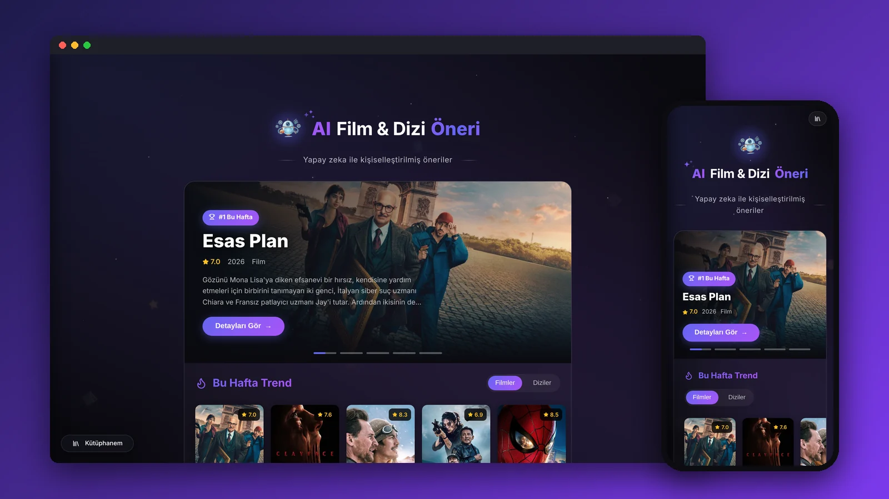

</div>

---

## ✨ Neler Yapabiliyor?

| | Özellik | Açıklama |
|:-:|---|---|
| 🤖 | **AI destekli öneri** | OpenRouter üzerinden ücretsiz LLM modelleri; biri yanıt vermezse sıradaki modele otomatik geçer |
| 💬 | **Doğal dil istekleri** | *"Geçen hafta The Office'i bitirdim, benzer bir komedi öner"* gibi serbest yazılar |
| 🎭 | **Ruh haline göre** | Mutlu, Üzgün, Heyecanlı, Rahat, Nostaljik |
| 🗂️ | **9 kategori** | Aksiyon, Komedi, Dram, Korku, Bilim Kurgu, Romantik, Animasyon, Belgesel, Gerilim |
| 🔥 | **Bu hafta trend** | TMDB'den haftanın popüler film ve dizileri; otomatik dönen vitrin + kaydırılabilir afiş şeridi |
| 🎞️ | **Detay penceresi** | Arka plan görseli, afiş, puan, oyuncu kadrosu, fragman ve *"neden önerildi?"* açıklaması |
| 🎭 | **Oyuncu profilleri** | Biyografi, doğum bilgisi ve tıklanabilir "Bilinen Yapımlar" listesi |
| 📚 | **Kütüphanem** | Beğendiğin içerikleri kaydet; Tümü / Filmler / Diziler sekmeleriyle filtrele |
| 🕘 | **Öneri geçmişi** | Önceki önerilerin tarayıcında saklanır |
| ☕ | **Cold start ekranı** | Render sunucusu uyurken sayaçlı, eğlenceli bilgiler gösteren bekleme ekranı |
| 📱 | **Responsive** | Glassmorphism arayüz, mobil ve masaüstüne uyumlu |

## 📸 Uygulama Turu

### 1 · Keşfet — Bu hafta trend olanlar

<table>
  <tr>
    <td width="50%">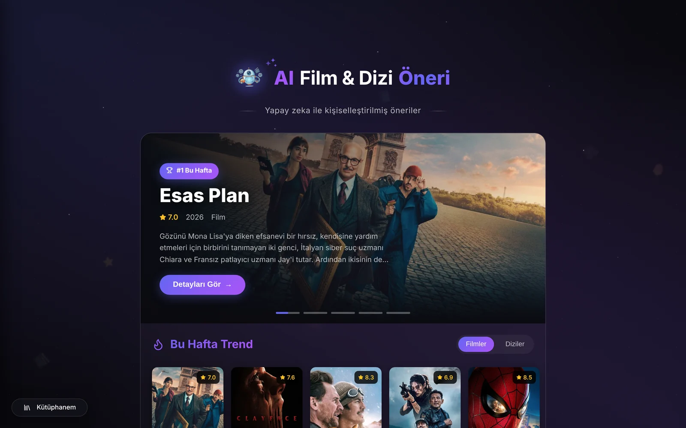</td>
    <td width="50%">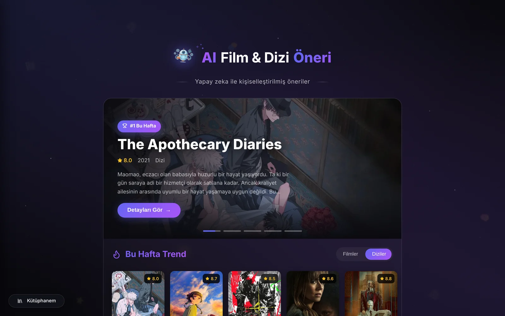</td>
  </tr>
  <tr>
    <td align="center"><sub>Haftanın filmleri: otomatik dönen vitrin ve afiş şeridi</sub></td>
    <td align="center"><sub>Tek tıkla dizilere geç</sub></td>
  </tr>
</table>

### 2 · İste — Ne izlemek istediğini anlat

<p align="center">
  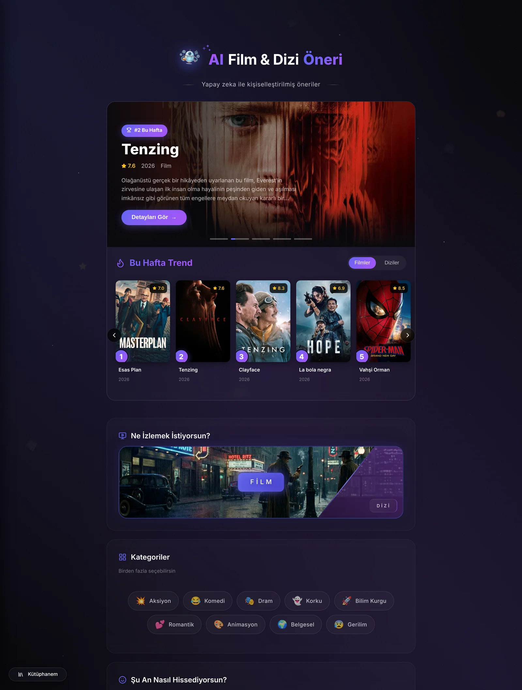
</p>
<p align="center"><sub>Film/Dizi seç, kategorileri ve ruh halini işaretle, aklındakini kendi cümlelerinle yaz</sub></p>

### 3 · Keşfet — AI'ın sana özel önerileri

<table>
  <tr>
    <td width="50%">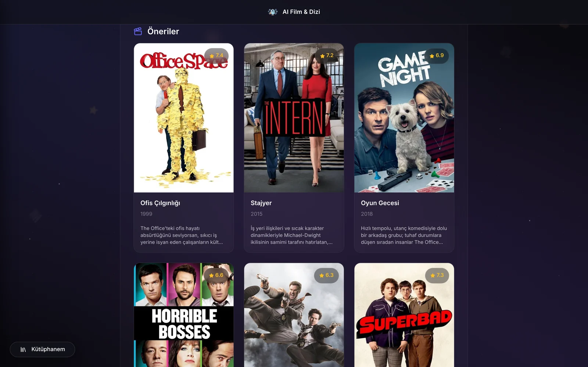</td>
    <td width="50%">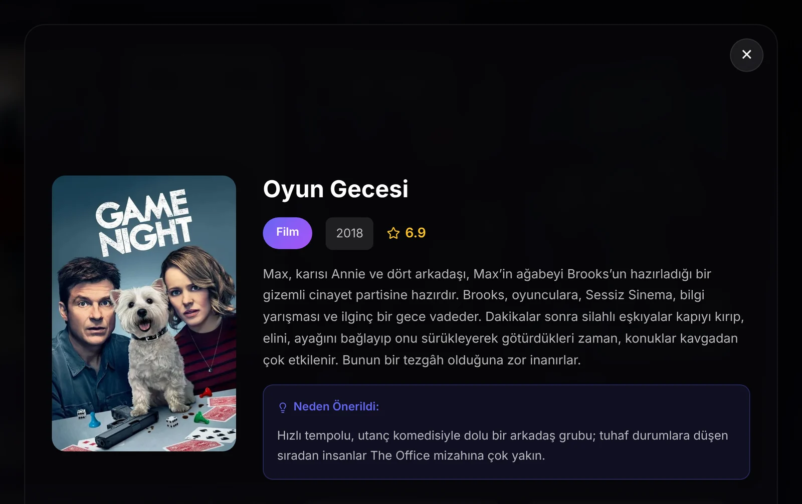</td>
  </tr>
  <tr>
    <td align="center"><sub>Afiş, puan ve kısa gerekçeyle 6 öneri</sub></td>
    <td align="center"><sub>Her önerinin <b>"Neden Önerildi?"</b> açıklaması</sub></td>
  </tr>
</table>

### 4 · Derinleş — Film detayları ve oyuncular

<table>
  <tr>
    <td width="50%">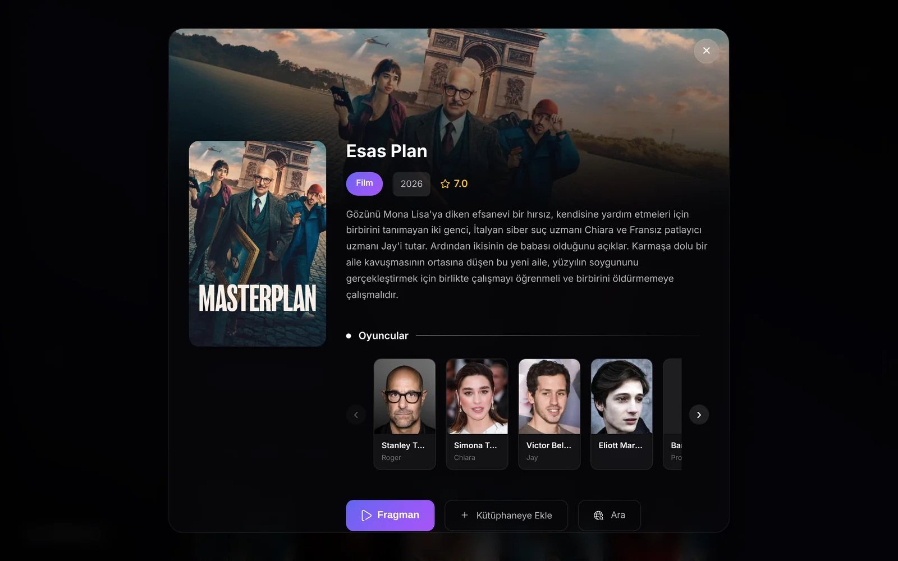</td>
    <td width="50%">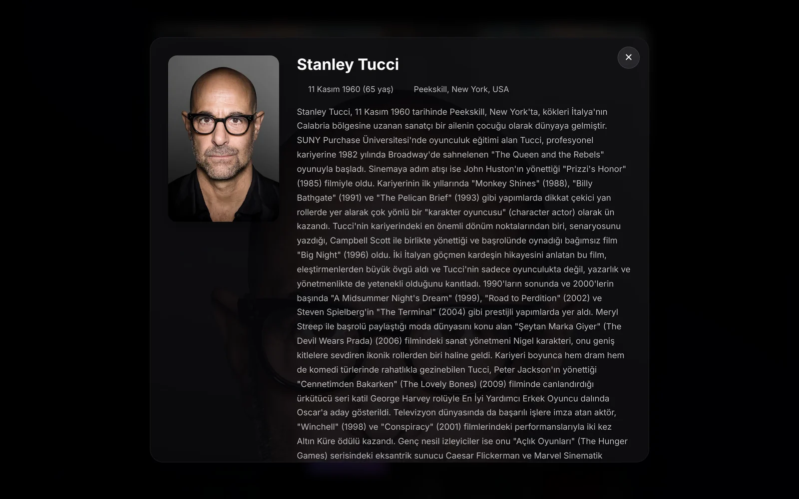</td>
  </tr>
  <tr>
    <td align="center"><sub>Detay penceresi: özet, oyuncu kadrosu, fragman, kütüphaneye ekle</sub></td>
    <td align="center"><sub>Oyuncuya tıkla → biyografi ve doğum bilgileri</sub></td>
  </tr>
  <tr>
    <td width="50%">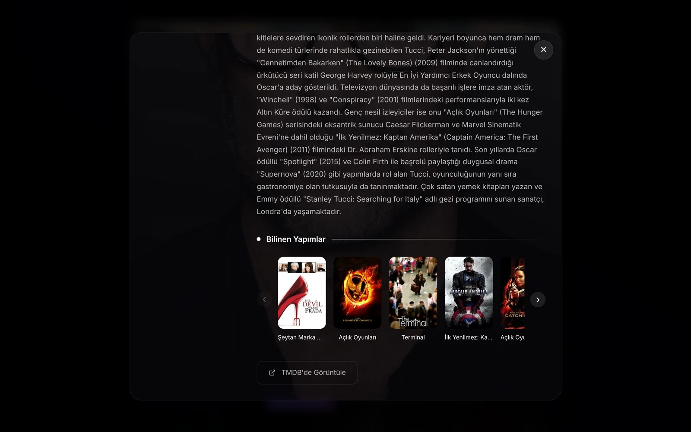</td>
    <td width="50%">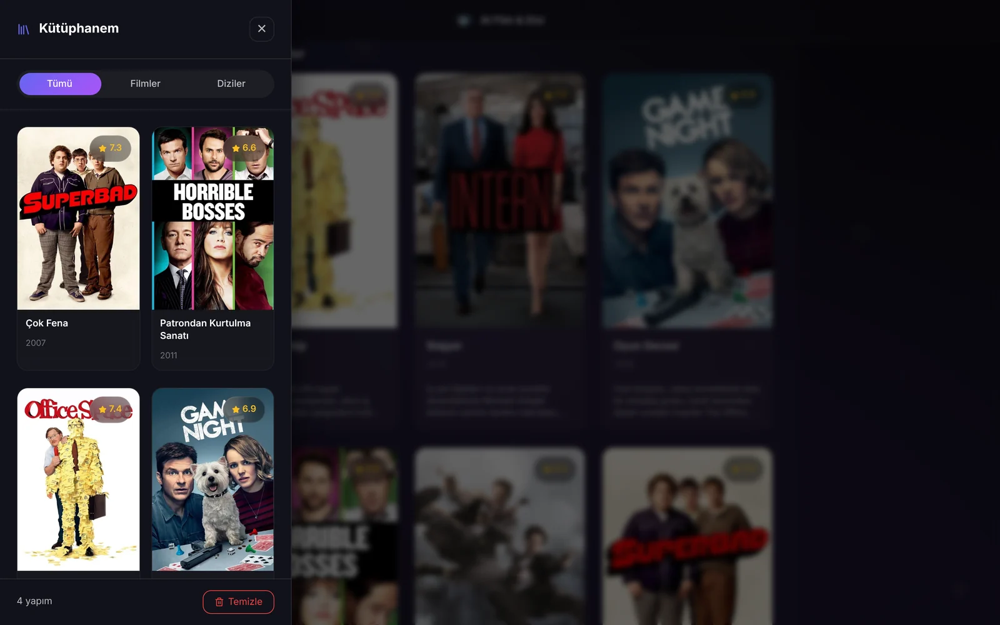</td>
  </tr>
  <tr>
    <td align="center"><sub>"Bilinen Yapımlar": bir filme tıkla, onun detayına geç</sub></td>
    <td align="center"><sub>Kütüphanem: kaydettiklerin tek panelde</sub></td>
  </tr>
</table>

### 📱 Mobilde

<p align="center">
  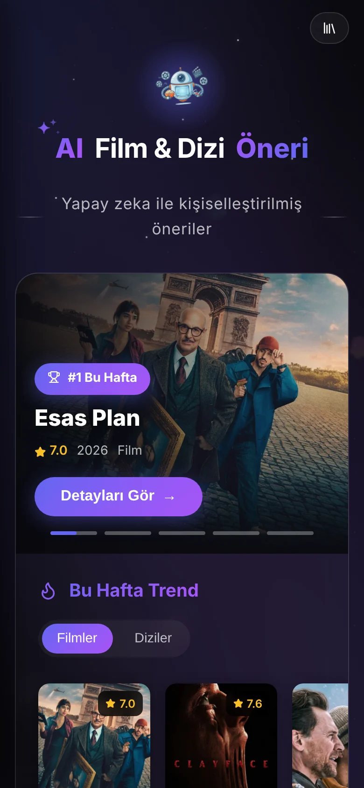
  &nbsp;
  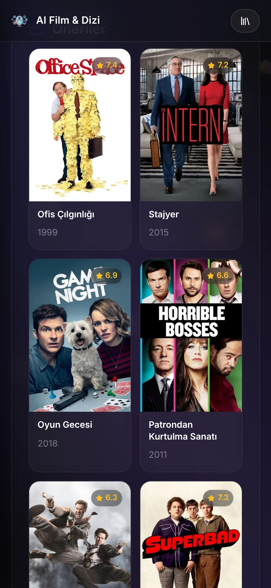
  &nbsp;
  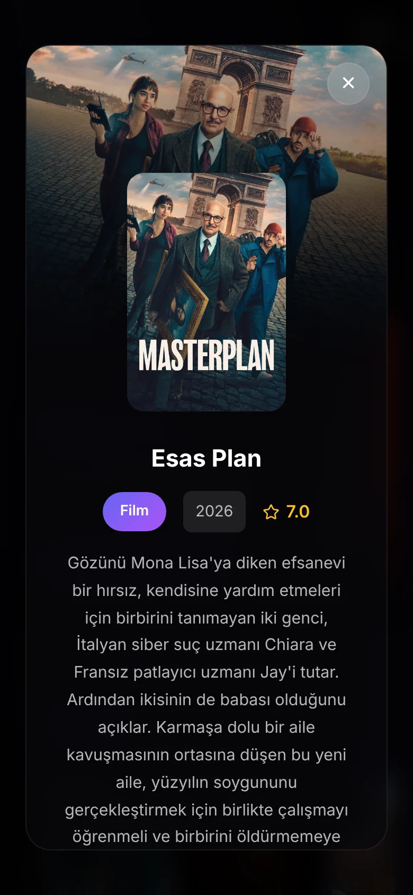
</p>

<details>
<summary><b>☕ Cold start ekranı</b> — sunucu uyurken ne görünüyor?</summary>
<br>
<p align="center">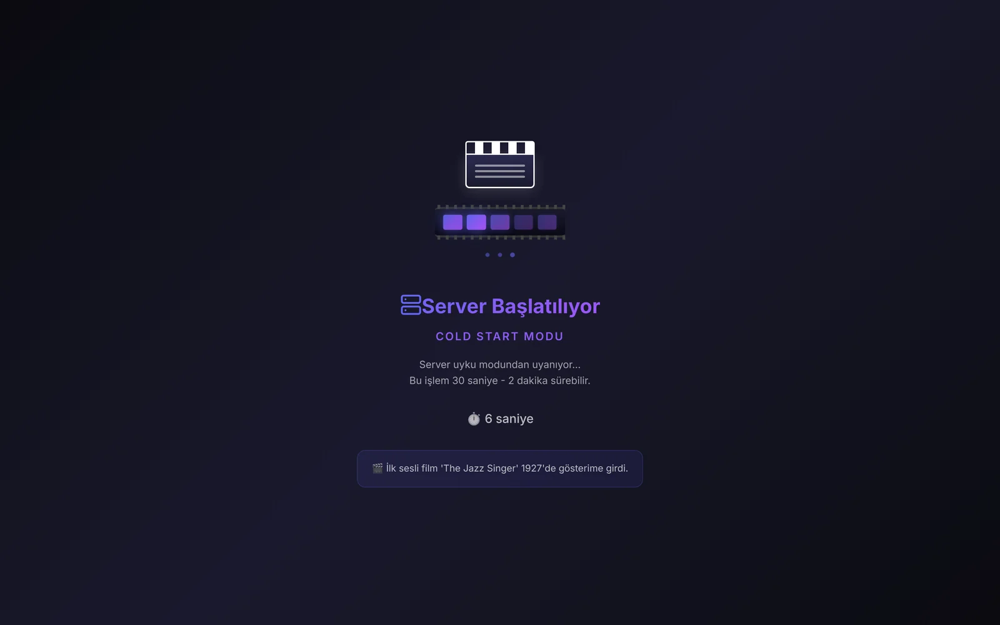</p>
<p align="center"><sub>Ücretsiz Render sunucusu uyku modundan uyanırken sayaç ve sinema bilgileriyle bekleme ekranı gösterilir.</sub></p>
</details>

## ⚙️ Nasıl Çalışır?

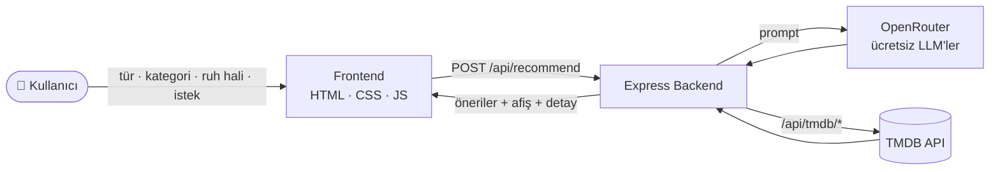

API anahtarları yalnızca backend'de durur; frontend hiçbir anahtarı görmez.

| Endpoint | Görev |
|---|---|
| `GET /api/health` | Sunucu durumu (Render uyku modundan uyanma kontrolü) |
| `POST /api/recommend` | AI'dan öneri alır |
| `POST /api/translate` | Açıklamaları Türkçeye çevirir |
| `GET /api/tmdb/*` | TMDB isteklerini güvenli şekilde aktarır |

## 🚀 Kurulum

**Gereksinimler:** Node.js 18+, [OpenRouter API anahtarı](https://openrouter.ai/keys), [TMDB API anahtarı](https://www.themoviedb.org/settings/api)

```bash
# 1. Repoyu klonla
git clone https://github.com/GurkanGurdal/Dizi_Film_AI_Oneri.git
cd Dizi_Film_AI_Oneri/server

# 2. Bağımlılıkları yükle
npm install

# 3. Ortam değişkenlerini ayarla
cp .env.example .env
```

`.env` dosyası:

```env
OPENROUTER_API_KEY=senin_openrouter_anahtarin
TMDB_API_KEY=senin_tmdb_anahtarin
PORT=5000
```

```bash
# 4. Sunucuyu başlat
npm start
```

Son olarak proje kökündeki `index.html` dosyasını tarayıcıda aç (veya VS Code Live Server ile çalıştır).

## 🗂️ Proje Yapısı

```
Dizi_Film_AI_Oneri/
├── index.html          # Arayüz
├── styles.css          # Glassmorphism tema ve animasyonlar
├── app.js              # Öneri akışı, trend vitrini, kütüphane, geçmiş
├── assets/             # Maskot ve görseller
└── server/
    ├── server.js       # Express API (OpenRouter + TMDB proxy)
    ├── package.json
    └── .env.example
```

## 🛣️ Yol Haritası

- [ ] Kullanıcı hesabı ile kütüphaneyi cihazlar arası senkronlama
- [ ] "Bunu izledim" geri bildirimiyle önerileri kişiselleştirme
- [ ] İzlenebileceği platformları gösterme (Netflix, Disney+ …)

## 👨‍💻 Geliştirici

**Gürkan Gürdal** · [@GurkanGurdal](https://github.com/GurkanGurdal)

<div align="center">

⭐ Projeyi beğendiysen yıldız vermeyi unutma!

</div>
